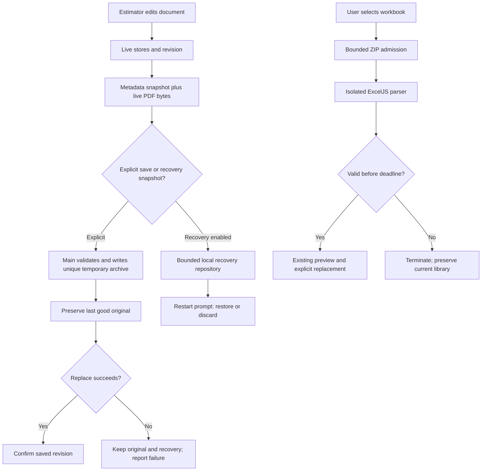

# Phase 20: Production Readiness - Research

> Planning update (2026-10-21): User approved existing internal exports only (client quotations deferred), safe replacement plus one last-good backup and periodic unsaved-work recovery with restart prompt, and UI-contract generation before planning. Conditional discussion below records options researched before those answers; the approved scope and current CONTEXT.md govern the plan.

**Researched:** 2026-10-21
**Domain:** Offline Electron Windows release, durable projects, upgrade compatibility and installed validation
**Confidence:** MEDIUM

<user_constraints>
## User Constraints (from CONTEXT.md)

The following context is copied verbatim. DATA_7Y42M9QK_START

## Locked outcomes

- Approximately 12 Windows PCs; versioned installers with internally distributed manual in-place upgrades. No auto-update hosting requirement. Final stable application identity, visible version, release notes, preserved projects/local library and verified fresh install/upgrade.
- Verify/repair existing embedded-PDF .clmc support rather than implement it again. Copy only the project to another PC and retain PDF/scales/geometry/prices/ordering, without source-path setup. Retain supported legacy migration.
- Agree minimal backup/recovery behavior during planning and implement it; preserve safe interrupted/failed saves, protect unsaved work and document rollback/project compatibility.
- Review supported runtime/dependencies, scaffold metadata/placeholder update endpoint and packaged content. Ensure test scratch data/planning assets and populated libraries are not shipped.
- Test installed app offline, representative large/multi-page PDFs, measurement accuracy, Windows scaling, save/reopen, rate application and exports on a non-development PC.
- Specifically validate changing measurement display units after pricing: current name|type project rates lack a persistent unit basis. No silent incorrect cost/quantity interpretation is acceptable at release.

## Approved planning decisions

RESOLVED by CONTEXT.md D-01: retain existing internal exports and defer client quotations. RESOLVED by D-02: implement safe replacement, one last-good backup and periodic local recovery including unsaved PDF bytes. D-04 authorizes autonomous routine technical choices and the local manual PC run; required external evidence remains an execution gate.

## Handover

Actual two-PC pilot, user acceptance and remaining-ten-PC distribution belong to Phase 21. Do not claim them from local automated verification.

## Phase 19 completion carry-forward (2026-10-21)

Phase 19 UAT is accepted (11/11); plan Phase 20 without repeating its completed walkthrough. Preserve the original three-phase rollout agreement.

- Security T19-06: 10 MB compressed-file and 10,000-row limits exist, but XLSX decompression/time is not independently bounded before ExcelJS load. Medium advisory, below Phase 19's high blocking threshold; investigate and bound resource use in the runtime/dependency resilience work before production rollout. See ../19-cost-library/19-SECURITY.md.
- Existing Electron host sandbox/navigation/external-link handling belongs in the supported-runtime review; no whole-app security certification was claimed by Phase 19.
- UI review passed with minor polish recommendations (status colors, small book-button target, numeric alignment); Windows scaling/long-content checks remain required installed-app validation. See ../19-cost-library/19-UI-REVIEW.md.
- Phase 21 guide should show Excel's UTF-8 comma-delimited Text Import Wizard route for exported CSV; the formatted XLSX opens directly.

DATA_7Y42M9QK_END

The context has no separate Discretion or Deferred Ideas section. The handover explicitly defers automatic updates/hosting, centralized or synchronized libraries, legacy XLS, custom export-template mapping, assemblies, cloud features and collaboration. [VERIFIED: .planning/RELEASE-HANDOVER.md, “Deferred” section; read this session]

**Pending at research completion:** Export audience and the exact minimum recovery behavior still require the user's answers. This document presents a recovery recommendation conditionally; it does not treat it as approved. [VERIFIED: orchestrator assignment and completion instruction, 2026-10-21]
</user_constraints>

## Project Constraints (from AGENTS.md)

- Deliver an installed Windows desktop application; core features must operate fully offline; support real construction PDFs and preserve exact markup positioning through zoom. [VERIFIED: AGENTS.md:11-16, read this session]
- Keep Electron, React, TypeScript, electron-vite, direct PDF.js and Konva architecture; follow existing code patterns. Review stale version recommendations against current official support information as explicitly required by this phase. [VERIFIED: AGENTS.md, Technology Stack and Architecture sections; CONTEXT.md locked outcomes]
- Keep filesystem access and workbook export in Electron main through IPC; preserve JSON project metadata with the existing embedded archive implementation. The older AGENTS path-reference description is superseded by the explicit Phase 20 instruction to verify existing embedded support. [VERIFIED: AGENTS.md, Stack Patterns; CONTEXT.md locked outcomes]
- Avoid CRA, legacy webpack boilerplates, react-pdf as the rendering abstraction, pdf-lib as renderer, a framework replacement, Redux/MobX and SQLite project persistence. [VERIFIED: AGENTS.md, What NOT to Use section]
- Start file changes inside a GSD workflow; this research belongs to the already invoked plan-phase workflow. Do not edit the managed developer profile. [VERIFIED: AGENTS.md, GSD Workflow Enforcement and Developer Profile sections]
- No project skill directories or knowledge graph were found by this session's directory probes; agent-skills query returned no configured injection. These are observations of these probes, not a claim about other machines. [VERIFIED: session directory probes and query agent-skills gsd-phase-researcher]

<phase_requirements>
## Phase Requirements

Descriptions below are copied from the requirements source. DATA_K86B1J4S_START

| ID | Description | Research Support |
|---|---|---|
| REL-01 | Versioned Windows installer, final stable identity, version visibility and release notes, manually distributed internally. | Identity contract, version IPC, bundled release notes, release manifest |
| REL-02 | Verified fresh install/in-place upgrade preserving user projects and local library, with supported runtime/package review. | Explicit userData preservation, supported Electron upgrade, package allowlist, installed checkpoint |
| REL-03 | Verify/repair single-file .clmc portability and supported migration without separate source PDF dependency. | Existing archive/hydrate seams, cross-PC transfer and legacy fixture matrix |
| REL-04 | Define and implement minimal backup/recovery and safe compatibility/rollback behavior. | Safe write repair, last-good backup, conditional unsaved recovery contract |
| REL-05 | Installed-app offline, large-PDF, measurement/Windows-scaling and export validation; resolve export audience before changing it. | Price-unit invariant, resource limits, installed evidence matrix, audience decision |

DATA_K86B1J4S_END [VERIFIED: .planning/REQUIREMENTS.md, Internal Production Rollout Requirements; read this session]
</phase_requirements>

## Summary

Plan this as release hardening of the existing application, with dedicated implementation work for durable writes, unit-safe pricing and constrained imports before packaging. The portable format is already implemented: the archive assembler writes both metadata and PDF; the serializer includes pricing and ordering; legacy opening explicitly populates PDF bytes. Rebuilding portability would repeat completed work. [VERIFIED: src/main/project-io.ts:106-135, quoted below; src/renderer/src/lib/project-serialize.ts:48-67, quoted below; src/renderer/src/hooks/useProject.ts:223-260]

The highest-risk finding is the shared save helper: it can unlink the destination after a failed rename and then remove its temporary file if all retries fail. Existing tests explicitly expect this behavior. Repair the project transaction and replace that expectation with data-preservation assertions. The application also recalculates quantities in the current display unit while retaining unqualified numeric rates, so a display-unit change can silently change money totals. [VERIFIED: src/main/ipc-handlers.ts:96-144 and src/tests/atomic-write.test.ts:64-97, quoted below; src/renderer/src/lib/boq-aggregator.ts:184-188,267-285; src/renderer/src/lib/boq-types.ts:12-19, quoted below]

Electron 35 reached end of life on 2025-09-02. The official release index observed here lists 45.0.0, 44.9.3 and 43.8.3 published on 2026-10-20. Plan a supported stable runtime upgrade before producing the release candidate; recheck versions at execution. Local tests and registry checks were attempted but restricted by sandbox filesystem/DNS failures, so neither a green baseline nor completed dependency verification is claimed. [CITED: https://releases.electronjs.org/schedule] [CITED: https://releases.electronjs.org/release] [VERIFIED: session command outputs, limitations below]

**Primary recommendation:** Implement safety and compatibility first, produce an allowlisted full NSIS installer second, and finish with an explicit non-development-PC validation gate. Keep the actual pilot and broad distribution in Phase 21. [VERIFIED: .planning/ROADMAP.md:744-774; implementation ordering is research recommendation]

## Architectural Responsibility Map

This is the recommended ownership map, grounded in the existing Electron split. [VERIFIED: src/main/index.ts:94-111; src/preload/index.ts:58-133; src/renderer/src/hooks/useProject.ts:98-145]

| Capability | Primary Tier | Secondary Tier | Rationale |
|---|---|---|---|
| Installer identity, versioned builds, package manifest | Build/NSIS | Main startup | Identity must be stable across full installer upgrades |
| Persistent directory and one-time data migration | Main / storage | Installer | Main resolves paths before repositories/browser sessions start |
| Project transaction, backup, recovery repository | Main / storage | Renderer snapshot producer | Only main writes files; renderer owns live editing state |
| Recovery prompt and revision bookkeeping | Renderer | Main | Prompt restores a recoverable snapshot without overwriting original |
| Unit basis and cost conversion | Pure domain code / renderer | Archive schema | One normalized calculation must feed Estimate and export |
| Untrusted workbook admission and parsing | Isolated Node utility process | Main orchestrator | Main controls deadline/termination and replacement transaction |
| PDF rasterization, coordinate transforms and memory cache | Renderer | PDF worker | Rendering resolution must remain independent of stored geometry |
| Installed release acceptance evidence | Human validation on target Windows PC | Automated artifact checks | Physical scaling, installer transitions and offline UX need actual installed execution |

## Standard Stack

Use the existing stack; do not upgrade every library incidentally. Installed versions observed through `npm ls --depth=0` were `electron@35.7.5`, `electron-builder@26.8.1`, `electron-vite@5.0.0`, `exceljs@4.4.0`, `jszip@3.10.1`, `pdfjs-dist@5.5.207`, `vite@7.3.1`, `vitest@4.1.1`. These are installed-version observations, not declarations that each is latest or vulnerability-free. [VERIFIED: session npm ls electron electron-builder electron-vite vite vitest exceljs jszip pdfjs-dist --depth=0]

| Component | Use in this phase | Version policy / evidence |
|---|---|---|
| Electron | Windows runtime, sandbox, IPC, utility process | Target current supported stable; official latest observed 45.0.0 (2026-10-20). Gate on release notes, installation and full regression. [CITED: https://releases.electronjs.org/release] |
| electron-builder / NSIS | Full offline Windows installer | Keep installed tool unless review requires an update; preserve NSIS identity. [CITED: https://www.electron.build/nsis/] |
| Existing React/TypeScript/Zustand/PDF.js/Konva | UI, document interaction, domain calculations | Preserve existing architecture. [VERIFIED: AGENTS.md, Technology Stack; package.json dependencies/devDependencies, read this session] |
| Existing JSZip | Assemble/extract self-contained projects | Reuse existing implementation; add admission limits without applying small spreadsheet limits to legitimate large projects. [VERIFIED: src/main/project-io.ts:106-135] |
| Existing ExcelJS | XLSX export and bounded admitted cost imports | Place import behind preflight/isolation; row checks after load are insufficient. [VERIFIED: src/main/cost-library.ts:17-55] |
| Node filesystem APIs | Unique temporary writes, flush, rename, backup | `writeFile` supports `flush`, using fsync; this improves durability but is not a promise against every power-loss/filesystem failure. [CITED: https://nodejs.org/docs/latest-v24.x/api/fs.html] |
| `yauzl` [WARNING: flagged as suspicious — verify before using.] | Recommended bounded streamed ZIP preflight, if added | Official README documents lazy entry processing and actual size validation; registry version/publish date could not be verified here. [CITED: https://github.com/thejoshwolfe/yauzl] |

**Installation:** No installation occurred during research. For an added ZIP reader or updated runtime, rerun registry/current-version/postinstall checks, resolve the legitimacy gate, then install an exact reviewed version and commit its lockfile during execution. Do not copy a version from training memory. [VERIFIED: research command log; recommendation]

### Alternatives Considered

| Preferred | Alternative | Decision |
|---|---|---|
| Full manual NSIS installer | Auto-update feed or web installer | Full internal manual installers are locked; no update service needed. [VERIFIED: CONTEXT.md locked outcomes] |
| Bounded streamed ZIP preflight plus killable parser | Merely race `xlsx.load` against a timer | Reject the timer-only design: it does not cancel the losing work. Use a supervisor that actually terminates execution. [CITED: https://www.electronjs.org/docs/latest/api/utility-process; design inference] |
| Utility process | Worker thread with heap limit alone | A worker is simpler to bundle, but its resourceLimits exclude ArrayBuffers and global OOM remains possible. It is not a complete memory boundary. [CITED: https://nodejs.org/docs/latest-v24.x/api/worker_threads.html] |
| Existing project archive and file APIs | SQLite or new project container | Preserve established project format and portability requirement. [VERIFIED: AGENTS.md, What NOT to Use; CONTEXT.md] |

## Package Legitimacy Audit

The required seam was run for Electron, electron-builder and the proposed ZIP reader. All returned `SUS` because registry signals were null, with `unknown-age`, `unknown-downloads`, `no-repository`. Separate npm probes failed with `getaddrinfo ENOTFOUND registry.npmjs.org`. This is a failed lookup, not evidence that these official projects lack a repository or are malicious. No package earns `[VERIFIED: npm registry]` here. [VERIFIED: session package-legitimacy and npm view outputs]

| Package | Registry | Age / downloads | Source repository | Verdict | Disposition |
|---|---|---|---|---|---|
| `electron` [WARNING: flagged as suspicious — verify before using.] | npm | Not observed: DNS failure | Official Electron project | SUS / incomplete lookup | Repeat gate and postinstall review before runtime install/update |
| `electron-builder` [WARNING: flagged as suspicious — verify before using.] | npm | Not observed: DNS failure | electron-userland/electron-builder | SUS / incomplete lookup | Preserve installed tool; repeat gate if updating/reinstalling |
| `yauzl` [WARNING: flagged as suspicious — verify before using.] | npm | Not observed: DNS failure | thejoshwolfe/yauzl | SUS / incomplete lookup | Planner must place `checkpoint:human-verify` before installing unless the gate is resolved first |

Source identities above are corroborated by official documentation/repositories, but the package legitimacy seam did not return OK. [CITED: https://www.electronjs.org/docs/latest/tutorial/installation] [CITED: https://www.electron.build/nsis/] [CITED: https://github.com/thejoshwolfe/yauzl]

**SLOP removals:** None returned. **SUS handling:** Do not silently waive this gate; repeat on the networked build host and review lifecycle scripts. Electron's installed metadata explicitly declares the lifecycle hook shown below; official installation documentation explains the binary download. This expected behavior still belongs in build/network planning. [VERIFIED: node_modules/electron/package.json:7-8] [CITED: https://www.electronjs.org/docs/latest/tutorial/installation]

DATA_M5V28RL0_START
```json
"postinstall": "node install.js"
```
DATA_M5V28RL0_END

## Architecture Patterns

### System Architecture Diagram

Recommended flow, grounded in the existing snapshot/IPC/repository seams; new recovery/import supervision are proposed additions. [VERIFIED: src/renderer/src/hooks/useProject.ts:98-145; src/main/cost-library-ipc.ts:43-65,77-89; design recommendation]



### Component Responsibilities and Concrete Seams

The following are existing source locations opened in this session, not claims that new runtime files already exist. [VERIFIED: corresponding source reads]

| Existing source | Phase 20 responsibility |
|---|---|
| `electron-builder.yml` | Stable installer identity, Windows target, explicit package inclusion, remove placeholder publish configuration |
| `package.json` | Real metadata/version, reproducible scripts and reviewed runtime declaration |
| `src/main/index.ts` | Early identity/storage setup, version API registration, sandbox/navigation/permissions policy |
| `src/main/project-io.ts` | Reuse archive assembly/extraction; bounded archive validation seam |
| `src/main/ipc-handlers.ts` | Repair project save transaction, protect originals, main-owned save serialization and IPC validation |
| `src/main/cost-library.ts` / `src/main/cost-library-ipc.ts` | Preflight/isolated parsing integration while preserving staged preview and explicit commit |
| `src/preload/index.ts` / `src/preload/index.d.ts` | Narrow typed version/recovery interfaces; maintain bridge rather than arbitrary IPC |
| `src/renderer/src/hooks/useProject.ts` | Coherent snapshot, save completion revision, restore/open integration |
| `src/renderer/src/lib/project-schema.ts` / `project-serialize.ts` | Rate basis persistence, legacy defaults and future-version refusal |
| `src/renderer/src/lib/boq-types.ts` / `boq-aggregator.ts` / `apply-library-rate.ts` | Persistent unit basis and invariant money calculations |
| `src/renderer/src/stores/projectStore.ts` / `scaleStore.ts` | Dirty/revision state and display-unit transition integration |
| `src/renderer/src/components/TitleBar.tsx` / `App.tsx` | Visible version and startup recovery prompt |
| `src/renderer/src/hooks/usePdfRenderer.ts` | Bounded canvas cache and resolution-independent geometry review |

New modules may be added adjacent to these existing responsibilities, but names and runtime directories must be defined by the plan; do not invent existing recovery-module paths. [ASSUMED: recommended organization]

### Pattern 1: Freeze identity while preserving data

Observed identity mismatch and scaffold configuration, verbatim: [VERIFIED: electron-builder.yml:1-2,15-20,41-43; src/main/index.ts:95; package.json:2-7]

DATA_B31T9XC6_START
```yaml
appId: com.electron.app
productName: clmc-takeoff
executableName: clmc-takeoff
artifactName: ${name}-${version}-setup.${ext}
provider: generic
url: https://example.com/auto-updates
```
```ts
electronApp.setAppUserModelId('com.clmc.takeoff')
```
```json
"name": "clmc-takeoff",
"version": "1.0.0",
"description": "An Electron application with React and TypeScript",
"author": "example.com",
"homepage": "https://electron-vite.org"
```
DATA_B31T9XC6_END

NSIS derives its upgrade GUID from appId/name; changing identity can split upgrade registration. Electron's default userData directory depends on application name, separately from appId. Freeze installer identity, runtime AUMID and storage location as three explicit decisions. Keep a stable existing userData directory even if visible product name changes, or perform a one-time validated copy while preserving the source and handling conflicts. Do not assume appId alone migrates files. [CITED: https://www.electron.build/nsis/] [CITED: https://www.electronjs.org/docs/latest/api/app]

Recommended visible title: CLMC Takeoff, with version obtained from main `app.getVersion()`, and offline release notes bundled as application content. Exact corporate publisher identity, signing credentials, distribution share and target architecture remain release-owner inputs; do not fabricate them. Build two monotonically versioned installers under the final identity to test real replacement; old scaffold installations, if any, need a separately documented transition. [ASSUMED: release design recommendation; name derives from current product UI]

### Pattern 2: Protect original, backup and in-flight edits

The dangerous branch is present verbatim: [VERIFIED: src/main/ipc-handlers.ts:96-98,104-108,118-140]

DATA_W7N1J5R2_START
```ts
const tmpPath = `${finalPath}.tmp`
await writeFile(tmpPath, data)
await rename(tmpPath, finalPath)
await unlink(finalPath)
try { await unlink(tmpPath) } catch { /* ignore */ }
```
DATA_W7N1J5R2_END

These statements occur along different branches; the excerpt is not an execution-ready sequence. The retry branch can delete the original before the replacement is secured. Use unique same-directory temporaries, one writer per destination, flush/close, archive validation and a last-good backup established before replacement. Retry replacement without deleting the only original; persistent locks must yield an actionable failure. Preserve dirty state and recoverable data on failed saves. Inject failure after every write/backup/rename stage and assert at least one validated last-good copy remains. [VERIFIED: src/main/ipc-handlers.ts:96-144; proposed repair is design recommendation]

Save completion currently unconditionally calls setSaved after an awaited write, and setSaved clears dirty state. Track a monotonic edit revision: acknowledge only the captured revision; edits that occurred while I/O ran must remain dirty. Capture metadata and its matching PDF once; serialize project save and recovery so PDF replacement/new/open cannot pair metadata with another document. [VERIFIED: src/renderer/src/hooks/useProject.ts:105-139; src/renderer/src/stores/projectStore.ts:135-147; recommended fix]

**Recovery option A (RESOLVED, approved per D-02):** Atomic safe save + one last-good backup + periodic local recoverable snapshots, including a never-saved project's PDF. Use a bounded local repository, retain the latest completed recovery while replacing it, and prompt on restart. Restore as dirty and require explicit Save/Save As; discard must be explicit. Never automatically overwrite a user's project. Plan 20-03 selects hash-addressed PDF blobs and completed metadata manifests, a 60-second dirty schedule, one latest completed candidate per document session and initial 20-candidate/4-GiB caps, to validate against representative plans. These are routine implementation choices under D-04; kept data survives quota pressure. Whole-PDF copying on every edit is inappropriate for large plans. [VERIFIED: CONTEXT.md D-02/D-04; 20-03-PLAN.md execution contract, implementation evidence pending]

**Recovery option B (RESOLVED, not selected):** Safe saves plus last-good backup alone does not meet D-02's approved unsaved-work recovery outcome and is excluded from the execution contract. [VERIFIED: CONTEXT.md D-02]

### Pattern 3: Persist rate basis, keep money invariant

Current rate definition and rate application, verbatim: [VERIFIED: src/renderer/src/lib/boq-types.ts:12-19; src/renderer/src/lib/apply-library-rate.ts:23-28]

DATA_0RK8L6P3_START
```ts
export interface PriceEntry {
  material: number
  labor: number
  markup: number
}
const key = `${labelToName(target.label)}|${target.type}`
project.setPrice(key, {
  material: source.material,
  labor: source.labor,
  markup: project.rates[key]?.markup ?? project.defaultMarkupPct
})
```
DATA_0RK8L6P3_END

The application validates matching units only at application time; aggregation later multiplies current display quantities by saved rates. Store an explicit per-rate basis for manual and imported prices; convert quantity to that basis for cost, and convert displayed unit rates inversely if the UI shows a different quantity unit. Keep one pure conversion feeding Estimate, totals and both exports. Retain the existing name/type key unless a deliberate migration requires otherwise. [VERIFIED: src/renderer/src/lib/apply-library-rate.ts:14-28; src/renderer/src/lib/boq-aggregator.ts:184-188,267-285; design recommendation]

Existing scale values, verbatim: [VERIFIED: src/renderer/src/types/scale.ts:9,22-28]

DATA_C93M6K2A_START
```ts
export type ScaleUnit = 'mm' | 'cm' | 'm' | 'in' | 'ft'
export const MM_PER_UNIT: Record<ScaleUnit, number> = {
  mm: 1,
  cm: 10,
  m: 1000,
  in: 25.4,
  ft: 304.8
}
```
DATA_C93M6K2A_END

Length conversion uses one power of the unit factor; area uses its square. Counts remain invariant. Treat wall area according to its actual existing aggregation path, which currently computes square metres independently of display length units. Test all row types and manual editing, rename/copy/move/undo/reopen. [VERIFIED: src/renderer/src/lib/boq-aggregator.ts:184-198,267-285; conversion recommendation]

Legacy basis inference cannot recover a unit that was never stored. Recommended compatibility policy: adopt the project's saved display unit as the old rates' initial interpretation, preserve current totals on initial open, persist that basis on next save and warn when history is ambiguous. A previously mispriced project cannot be proven corrected from its archive alone. Define rollback protection: older builds that ignore the new basis must not be allowed to silently rewrite priced projects. Use an explicit supported-reader/version strategy or require pre-upgrade copies for rollback; additive fields alone are insufficient when old code ignores their meaning. [ASSUMED: A2 legacy pricing migration/rollback policy requiring confirmation]

### Pattern 4: Reuse portable projects and strengthen validation

The existing archive entries and persisted fields are verbatim: [VERIFIED: src/main/project-io.ts:110-115; src/renderer/src/lib/project-schema.ts:64-82,99,108,119; src/renderer/src/lib/project-serialize.ts:60-67]

DATA_N46Q7V1D_START
```ts
zip.file('project.json', projectJson, { compression: 'STORE' })
zip.file('plan.pdf', pdfBytes, { compression: 'STORE' })
formatVersion: 2
rates?: Record<string, PriceEntry>
defaultMarkupPct?: number
categoryItemOrder?: Record<string, string[]>
categoryItemOrder: markup.categoryItemOrder,
currentPage: viewer.currentPage,
pages,
hiddenItemNames: useProjectStore.getState().hiddenItemNames,
rates: useProjectStore.getState().rates,
defaultMarkupPct: useProjectStore.getState().defaultMarkupPct
```
DATA_N46Q7V1D_END

Test a real archive assembled from snapshot state, clear all stores and source-path availability, then extract/hash/load/hydrate and compare PDF bytes, geometry, scales, rate basis, prices and ordering. Include historical JSON migration with a readable source PDF, missing-source failure preserving the active project, malformed archives, checksum mismatch and unsupported future format. Legacy opening currently reads its external PDF before migrating; supported migration needs that original once, whereas saved embedded archives must not. [VERIFIED: src/main/project-io.ts:125-135; src/renderer/src/hooks/useProject.ts:223-260; src/renderer/src/lib/project-schema.ts:187-199]

Validation currently checks top-level structure then casts; do not mistake it for deep validation of page/geometry counts, finite coordinates or nested scale values. Add narrowly scoped finite/range/collection checks at the trusted import boundary for this release, while preserving valid historical projects. [VERIFIED: src/renderer/src/lib/project-schema.ts:124-150; recommended repair]

### Pattern 5: Bound workbook work before loading

Current hard limits and parser order, verbatim: [VERIFIED: src/main/cost-library.ts:17,22-29,43-46]

DATA_R9T3G5M8_START
```ts
export const MAX_LIBRARY_FILE_BYTES = 10 * 1024 * 1024
await workbook.xlsx.load(data as unknown as ExcelJS.Buffer)
if (sheet.rowCount > MAX_LIBRARY_ITEMS + 1 || sheet.columnCount > 50)
```
DATA_R9T3G5M8_END

Enforce compressed input size, ZIP entry count, declared per-entry/aggregate inflated size, and streamed actual inflated byte totals before calling ExcelJS. Check every entry, including unused worksheets/media; reject encryption, unsupported methods and malformed size metadata. Count output as it streams rather than allocating an oversized entry and checking afterward. Run the full preflight plus ExcelJS parse under a supervisor deadline in a killable utility process; on timeout, child crash, malformed data or over-budget result, preserve the current library and expire the candidate. The existing token-bound preview/commit protocol remains the replacement boundary. [CITED: https://github.com/thejoshwolfe/yauzl] [CITED: https://raw.githubusercontent.com/exceljs/exceljs/master/lib/xlsx/xlsx.js] [CITED: https://www.electronjs.org/docs/latest/api/utility-process] [VERIFIED: src/main/cost-library-ipc.ts:43-89]

Absolute resource budgets must be measured with the app's blank template and a valid maximum-row workbook, then recorded as constants and tested against over-limit fixtures. A fixed compression-ratio threshold alone can reject legitimate repetitive XML and is not a substitute for absolute byte limits. Exact byte/time budgets remain proposed engineering settings, not existing controls or approved performance targets. [ASSUMED: A3 resource budget recommendation]

### Pattern 6: Package allowlist and offline host

Use a positive inclusion list for built application output and required runtime resources. Inspect the actual archive and unpacked resources, not merely source configuration. Assert required PDF worker/assets and imported module dependencies exist; assert planning docs, tests, scratch projects, imported prices and developer configuration are absent. Removing the placeholder publish stanza does not itself establish offline behavior: test with networking disabled. [VERIFIED: electron-builder.yml:5-13,41-43; electron.vite.config.ts:23-33; recommendation]

Host controls currently include the following verbatim settings: [VERIFIED: src/main/index.ts:28-33,76-79; src/renderer/index.html:7-9]

DATA_V8X1P4C7_START
```ts
contextIsolation: true,
nodeIntegration: false,
sandbox: false,
shell.openExternal(details.url)
```
```text
default-src 'self'; script-src 'self'; worker-src 'self' blob:; style-src 'self' 'unsafe-inline'; img-src 'self' data: blob:
```
DATA_V8X1P4C7_END

Enable and test sandbox-compatible preload bundling; deny unexpected navigation/window creation and permissions. If external links are needed, allow only explicit trusted protocols/destinations; do not pass arbitrary URLs to the shell. Validate privileged IPC sender/frame and payload rather than relying on TypeScript or contextIsolation alone. Preserve local blob worker/CSP needs when hardening. [CITED: https://www.electronjs.org/docs/latest/tutorial/security] [CITED: https://www.electronjs.org/docs/latest/tutorial/sandbox] [VERIFIED: src/preload/index.ts:1-4,58-133; src/renderer/src/lib/pdf-setup.ts:78-84,136-165]

## Don't Hand-Roll

| Problem | Don't build | Use instead | Evidence |
|---|---|---|---|
| Windows upgrade/install registration | Custom executable copier | Existing electron-builder NSIS with fixed identity | [CITED: https://www.electron.build/nsis/] |
| ZIP envelope and decompression | Ad hoc central-directory parser/inflater | Reviewed streamed ZIP library plus explicit budgets | [CITED: https://github.com/thejoshwolfe/yauzl] |
| Crash-prone parser lifecycle | Main-thread timer without cancellation | Electron utility process with parent termination | [CITED: https://www.electronjs.org/docs/latest/api/utility-process] |
| PDF persistence | New container format or external path workaround | Existing embedded archive and cached original bytes | [VERIFIED: src/main/project-io.ts:106-135; src/renderer/src/hooks/useProject.ts:105-138] |
| Unit conversion tables | Independent factors scattered through UI/export | Existing canonical scale table and one pure conversion | [VERIFIED: src/renderer/src/types/scale.ts:22-28, quoted above] |
| Cryptographic hash | Custom checksum | Existing Node SHA256 helper | [VERIFIED: src/main/project-io.ts:27-28, `return createHash('sha256').update(buf).digest('hex')`] |

## Runtime State Inventory

This phase changes identity/runtime and migrates pricing, so all five categories are explicit. No external-service or OS-state cleanup is authorized by this research. [VERIFIED: phase scope; research boundary]

| Category | Items found / observation | Required plan action |
|---|---|---|
| Stored data | Main creates the library at `join(directory, 'cost-library-v1.json')` and constructs the repository using `app.getPath('userData')`. Local APPDATA enumeration also observed two app-like directories, and a library file in the current one; contents were not exposed. UI preferences use `const STORAGE_KEY = 'clmc.ui'`. [VERIFIED: src/main/cost-library.ts:128,148-149; src/main/cost-library-ipc.ts:14; src/renderer/src/hooks/useUiPanels.ts:41,77-79] | Preserve library and workstation state; explicitly pin storage or validate one-time copy. Migrate existing project rates when opened/saved; keep originals. |
| Live service config | Placeholder updater URL is configured in build YAML as quoted above. A lookup is not evidence of a deployed service; no live service was inspected. [VERIFIED: electron-builder.yml:41-43] | Remove unused feed configuration. No hosting/synchronization provisioning. |
| OS-registered state | Runtime AUMID and builder appId differ, as quoted above. Installed registrations on other PCs were not available for inspection. [VERIFIED: src/main/index.ts:95; electron-builder.yml:1] | Inspect actual installed/uninstall/shortcut state during upgrade checkpoint; test final identity with predecessor and successor installers. |
| Secrets/env vars | Development load uses `process.env['ELECTRON_RENDERER_URL']`; signing/distribution credentials were not inspected or claimed present. [VERIFIED: src/main/index.ts:82-83] | Keep dev URL conditional; define signing ownership if used. Do not package environment files or copy secrets. |
| Build artifacts / installed packages | Installed Electron metadata reports `"version": "35.7.5"`; current build output is not release evidence. [VERIFIED: node_modules/electron/package.json:26] | Rebuild after reviewed runtime/config changes; inspect resulting installed binaries and package inventory. |

## Common Pitfalls

1. **Deleting the original to recover a rename.** A lock workaround becomes project loss after a second failure. Replace the project-specific behavior and the existing test expectation; include real filesystem tests and interrupted stages. [VERIFIED: src/main/ipc-handlers.ts:118-140; src/tests/atomic-write.test.ts:64-97]
2. **Recovery without PDF bytes.** Metadata alone cannot reopen a never-saved project after the original PDF becomes unavailable. Recovery must reference a durable validated local PDF blob or a full archive, and preserve the viewer's source bytes when transferring to PDF workers. [VERIFIED: src/renderer/src/hooks/useProject.ts:105-138; src/renderer/src/lib/pdf-setup.ts:146-165; design inference]
3. **Clearing dirty after a stale save.** New edits during awaited I/O can be hidden by unconditional setSaved. Assert revision behavior in tests. [VERIFIED: src/renderer/src/hooks/useProject.ts:113-139; src/renderer/src/stores/projectStore.ts:135-147]
4. **Persisting numeric prices without units.** Applied-rate compatibility at one moment cannot protect later display-unit changes. Metamorphic tests must show constant cost, price and margin across unit changes and reopen. [VERIFIED: src/renderer/src/lib/apply-library-rate.ts:14-28; src/renderer/src/lib/boq-aggregator.ts:267-285]
5. **Silent backward compatibility.** An older reader may discard/ignore new pricing semantics while still accepting the archive version. Document a real reader/version policy and retain pre-upgrade copies. [VERIFIED: src/renderer/src/lib/project-schema.ts:124-150,187-199; design inference]
6. **Memory tests limited to one page.** The renderer's pageCache is a Map populated on current/adjacent render, cleared on document replacement and without an eviction branch in the inspected implementation. Plan a bounded cache repair and a navigation soak on representative large documents. [VERIFIED: src/renderer/src/hooks/usePdfRenderer.ts:25-34,79-83,137-174]
7. **DPI changes geometry indirectly.** Raster render scale is clamped using devicePixelRatio, then viewport dimensions are used as page size. Validate independent stored page coordinates when resolution/DPI changes, including save/reopen and monitor transition; do not assert accuracy from arithmetic tests alone. [VERIFIED: src/renderer/src/hooks/usePdfRenderer.ts:6-15,114-140]
8. **Packaging tests from source only.** Existing exclusion-only patterns do not demonstrate actual payload contents. Produce and inspect the exact installer candidate and run installed worker/import/recovery flows. [VERIFIED: electron-builder.yml:5-13; recommendation]

## Code Examples

Existing archive pattern (verbatim; retain this seam): [VERIFIED: src/main/project-io.ts:106-116]

DATA_E3Q6H8W2_START
```ts
export async function assembleClmcZip(
  projectJson: string,
  pdfBytes: Buffer
): Promise<Buffer> {
  const zip = new JSZip()
  zip.file('project.json', projectJson, { compression: 'STORE' })
  zip.file('plan.pdf', pdfBytes, { compression: 'STORE' })
  return await zip.generateAsync({
    type: 'nodebuffer',
    compression: 'STORE'
  })
}
```
DATA_E3Q6H8W2_END

Official filesystem API pattern; identifiers below are generic arguments, not proposed repository fields/paths: [CITED: https://nodejs.org/docs/latest-v24.x/api/fs.html]

```ts
import { writeFile, rename } from 'node:fs/promises'

// The transaction separately protects a validated prior version first.
await writeFile(temporaryPath, archiveBytes, { flag: 'wx', flush: true })
await rename(temporaryPath, destinationPath)
// Never unlink the only good destination to make this rename succeed.
```

For pricing, use this invariant as the test oracle, not an implementation-mirroring assertion: quantity in original basis × original unit rate must equal quantity in displayed basis × displayed unit rate, within a specified numerical tolerance; geometry and selling markup remain unchanged. No new persisted field names are prescribed here. [ASSUMED: recommended validation oracle; uses current pricing formula verified above]

## State of the Art

| Existing approach | Release approach | Reason / evidence |
|---|---|---|
| Electron 35.7.5 | Supported stable Electron with reviewed patch pin | 35 EOL is explicitly listed in official schedule. [CITED: https://releases.electronjs.org/schedule] |
| Placeholder update feed | Internally distributed full versioned installer | Locked manual-upgrade model. [VERIFIED: CONTEXT.md] |
| External source PDF in legacy JSON | Existing embedded archive on successful migration | Already implemented; test migration once then path independence. [VERIFIED: src/renderer/src/hooks/useProject.ts:223-260; src/main/project-io.ts:110-115] |
| Compressed bytes + post-load row count | Pre-load inflated-byte admission and terminable parse | Current row checks occur after ExcelJS load. [VERIFIED: src/main/cost-library.ts:22-46] |
| Unqualified project rates | Explicit persistent unit basis | Required to avoid silent repricing from display changes. [VERIFIED: src/renderer/src/lib/boq-types.ts:12-19; boq-aggregator.ts:267-285] |

Do not remove PDF polyfills or blob worker handling merely because a newer Chromium is selected. Verify packaged PDF behavior first, then remove only proven obsolete compatibility code in a separate justified change. [VERIFIED: src/renderer/src/lib/pdf-setup.ts:15-142; recommendation]

## Assumptions Log

| ID | Proposed assumption / decision | Section | Risk if wrong |
|---|---|---|---|
| A1 | RESOLVED scope per D-02; Plan 20-03 specifies interval, repository caps/retention and durable PDF strategy under D-04 | Recovery | Validate disk growth and large-PDF performance during execution; preserve kept work if caps reject new snapshots |
| A2 | Legacy prices adopt saved display basis; reader/version and rollback policy | Unit basis | Existing ambiguous prices may be misinterpreted; old reader may rewrite new semantics |
| A3 | Byte/entry/deadline budgets calibrated against valid maximum library and lowest-spec target PC | Workbook | Excessively low budgets reject valid inputs; high budgets leave denial-of-service risk |
| A4 | Stable current userData path, final identity and per-user installer mode selected after registration inspection | Identity | Unintended duplicate installation or apparently lost local library |
| A5 | Release owner supplies publisher/signing/distribution details and target architecture | Release | Installer cannot be identified/reproduced/distributed as intended |
| A6 | New implementation modules colocated with inspected seams and one common pricing conversion/test oracle | Organization/code examples | Planner must specify names/contracts before execution |

These are design recommendations rather than claims of existing behavior. Resolve product-scope choices with the pending user responses; routine implementation details can be made concrete by the planner within approved scope. [ASSUMED: assumption classification]

## Open Questions

RESOLVED here means the planning disposition is explicit. It does not assert that pending execution checks or external evidence have passed.

1. **Export audience — RESOLVED (D-01):** Keep existing internal exports; client quotations are deferred and excluded from Phase 20. Plans 20-02, 20-06, 20-07 and 20-09 preserve that boundary. [VERIFIED: CONTEXT.md D-01; named plans]
2. **Recovery scope — RESOLVED (D-02/D-04):** Safe replacement, one last-good backup and periodic recovery including unsaved PDF bytes are approved. Plans 20-01 and 20-03 implement the contract; 20-03 specifies the 60-second schedule, completed-candidate retention and measured initial quotas. No further product-scope answer is required. [VERIFIED: CONTEXT.md D-02/D-04; named plans]
3. **Existing installed identity/data — RESOLVED (execution gate):** Plan 20-05 task 1 inspects actual registration/storage before freezing identity, pins existing userData and tests preserved state. Plan 20-09 requires actual predecessor inventory and installed upgrade evidence. Whether a deployed predecessor exists remains unproven until inspection; local directory names are not that proof. [VERIFIED: 20-05-PLAN.md task 1; 20-09-PLAN.md tasks 2/3]
4. **Target evidence/material — RESOLVED (external evidence gate):** Plan 20-09 tasks 2/3 define candidate-bound machine/fixture/physical-scaling evidence and require an accessible non-development Windows PC. D-04 permits the authorized local PC run. Unavailable target-PC/material checks stay pending/blocked; local results cannot satisfy non-development-PC acceptance or Phase 21 pilot acceptance. No such target testing occurred in research. [VERIFIED: CONTEXT.md D-04; 20-09-PLAN.md tasks 2/3]
5. **Dependency verification — RESOLVED (conditional package gate):** Plan 20-05 task 2 retries official registry/version/source/lifecycle/support checks and records exact evidence before task 3 installs anything. Factual OK evidence resolves the conditional gate; remaining ASSUMED/SUS findings require its explicit blocking-human disposition. The recorded DNS/realpath failures remain research limitations, with the green test/build baseline still to establish during execution. [VERIFIED: 20-05-PLAN.md tasks 2/3; command failures below]

### Plan scope warning disposition

The eight plans with 10–13 aggregate files retain one atomic capability each: 20-01 safe saves (12 files, 47k tokens), 20-02 rate-basis invariance (11, 44k), 20-03 restart recovery (12, 48k), 20-04 release information (10, 26k), 20-05 identity/runtime continuity (10, 35k), 20-06 bounded workbook imports (12, 46k), 20-07 portable-format compatibility (13, 47k), and 20-09 candidate/evidence validation (10, 42k). Each has 2–3 tasks and each task owns at most five modified files. The estimates stay within 48% of the reviewed 100k-token context envelope; the aggregate file warning is accepted on those explicit bounds.

Preserve the existing tracer-first capability ownership, dependencies and waves. Related cross-layer files are necessary to make each task runnable; fragmenting these atomic paths into more plans would add handoffs without reducing a task's file surface. Executors must retain command-level verification, checkpoint completed work before context pressure, and return a precise continuation/checkpoint if measured execution exceeds the estimate. Package legitimacy and actual non-development-PC evidence remain explicit gates; this scope rationale cannot waive them or omit any task.

## Environment Availability

| Dependency | Available here | Observation | Fallback / plan |
|---|---|---|---|
| Node / npm | Yes | Node v24.13.0, npm 11.8.0 from version probes. [VERIFIED: session commands] | Use reproducible documented build-host runtime; installer bundles its own runtime |
| Installed local dependencies | Yes | Versions listed in Standard Stack from npm ls. [VERIFIED: session command] | Use lockfile and registry review during execution |
| Context7 MCP / ctx7 CLI | Not available to this research | Tool discovery had no Context7 and CLI command lookup failed. [VERIFIED: session discovery] | Used primary official web sources after research-plan seam requested Context7 |
| npm registry through shell | Lookup failed | ENOTFOUND registry.npmjs.org. [VERIFIED: npm view output] | Rerun on authorized networked build host; no registry finding inferred |
| Vitest | Launches, suites not imported | EPERM realpath from Vite on all five selected suites. [VERIFIED: test command output] | Rerun in normal project execution environment; no pass claimed |
| Official documentation | Yes | Primary sources fetched and cached through research-store. [VERIFIED: tool log] | Recheck release index at execution |
| Target non-development Windows PC | Not observed | No installed testing or deployment performed. [VERIFIED: session activity] | Required human installed-validation checkpoint |

The build host can require internet for package/runtime installation while the installed estimator workflow must work offline. Keep those two requirements separate. [VERIFIED: CONTEXT.md offline release goals; recommended build practice]

## Validation Architecture

Enabled by the existing planning configuration. Current test configuration contains `environment: 'node'` and `include: ['src/tests/**/*.test.ts']`; package scripts define the commands below and no test script was present in the file read. [VERIFIED: vitest.config.ts:4-13; package.json:8-21]

DATA_F64J1S8N_START
```text
typecheck: npm run typecheck:node && npm run typecheck:web
build: npm run typecheck && electron-vite build
build:unpack: npm run build && electron-builder --dir
build:win: npm run build && electron-builder --win
```
DATA_F64J1S8N_END

| Property | Value |
|---|---|
| Framework | Installed Vitest 4.1.1; node default, file-level DOM annotations in UI suites. [VERIFIED: session npm ls; vitest.config.ts:4-13; src/tests/cost-library-ui.test.ts inspected by source discovery] |
| Quick command | `.\node_modules\.bin\vitest.cmd run src/tests/project-io.test.ts src/tests/atomic-write.test.ts src/tests/cost-library-apply.test.ts --reporter=dot` |
| Full suite | `.\node_modules\.bin\vitest.cmd run` |
| Type/build | `npm run typecheck`; `npm run build:win` |

Commands are grounded in current binaries/config/scripts; quick duration under 30 seconds must be confirmed after filesystem access works. The research attempt selected five relevant suites and ended in 3.89 seconds with **no tests run**, because imports failed: [VERIFIED: session Vitest output]

DATA_U9G2M5L6_START
```text
Error: EPERM: operation not permitted, realpath 'C:\Users\Admin\Roaming\CLMC TAKEOFF APP\src\tests\atomic-write.test.ts'
Test Files  5 failed (5)
Tests  no tests
```
DATA_U9G2M5L6_END

### Phase Requirements → Test Map

Existing test locations were discovered and key persistence/pricing tests opened; new files below are explicitly proposed. No installed/human result is implied. [VERIFIED: session source reads and file inventory]

| Requirement | Behavior | Test level / evidence | Automated command / checkpoint | Exists? |
|---|---|---|---|---|
| REL-01 | Consistent identity/version, no placeholder host, expected payload | Build artifact assertions plus installer inspection | `npm run build:win`, then inspect candidate archive/resources and version | Build script yes; artifact assertion gap |
| REL-02 | Fresh/upgrade preserves library and projects | Repository integration plus real installer transition | Existing cost-library/store/IPC suites; non-dev-PC fresh and predecessor→candidate upgrade | Unit suites yes; installed evidence pending |
| REL-03 | Embedded transfer, geometry/prices/order, v1 migration | Real archive + store integration and manual second-PC copy | `.\node_modules\.bin\vitest.cmd run src/tests/project-io.test.ts src/tests/project-serialize.test.ts src/tests/project-order-roundtrip.test.ts src/tests/v1-migration-pdfbytes.test.ts` | Existing suites; add combined archive fixture |
| REL-04 | Every save failure preserves good data; recovery includes unsaved PDF | Fault injection, actual temporary-directory integration, restart recovery | `.\node_modules\.bin\vitest.cmd run src/tests/atomic-write.test.ts`; extend/add transaction/recovery suites | Atomic suite yes; recovery and revision gaps |
| REL-05 | Unit changes preserve cost; import limits retain library | Domain invariant and isolated parser integration | `.\node_modules\.bin\vitest.cmd run src/tests/cost-library-apply.test.ts src/tests/cost-library.test.ts src/tests/cost-library-ipc.test.ts src/tests/boq-aggregator.test.ts` | Existing suites; conversion/resource gaps |
| REL-05 | Offline installed PDF/measurement/DPI/export behavior | Actual installed manual evidence | Recorded candidate hash, machine details, fixtures and expected/actual results | Pending; cannot be replaced by mocked unit tests |

### Sampling Rate

- Per implementation task: affected focused Vitest suites and relevant typecheck. [ASSUMED: proposed sampling policy]
- Per wave: full suite and `npm run typecheck`; build/package after runtime/identity/config/worker changes. [ASSUMED: proposed sampling policy]
- Phase gate: full suite/build artifact checks plus completed installed non-development-PC checks before production-readiness acceptance. Phase 21 still owns pilot acceptance and remaining distribution. [VERIFIED: ROADMAP.md:750-774; sampling recommendation]

### Wave 0 Gaps

- Replace destination-unlink project tests with failure matrix proving original/backup validity; add real filesystem roundtrip, ENOSPC/EACCES, persistent lock and stale-save revision cases. [VERIFIED: src/tests/atomic-write.test.ts:64-97; recommended additions]
- Add end-to-end archive fixture using the real assembler/extractor plus stores, including pricing basis, ordering and source-PDF absence. [VERIFIED: src/tests/project-io.test.ts and src/tests/cost-library-apply.test.ts cover separate layers; recommended addition]
- Add unsaved recovery restart/restore/discard tests per approved D-02 and Plan 20-03, with missing/corrupt recovery PDF, in-flight save and library isolation. [VERIFIED: CONTEXT.md D-02; 20-03-PLAN.md execution contract]
- Add linear, perimeter, area, wall and count cost invariance across every supported display unit, save/reopen, manual changes and group operations. Existing application test uses a count target, which cannot expose length/area conversion failures. [VERIFIED: src/tests/cost-library-apply.test.ts:16-43; recommended additions]
- Add generated low-compressed/high-expanded workbook, excessive entries, dishonest sizes, timeout and child-crash cases; assert parent responsiveness and unchanged library. Add valid maximum template success test. [VERIFIED: src/main/cost-library.ts:17-55; recommended additions]
- Add artifact-content manifest and a release-validation record template with explicit pending/manual statuses. New filenames belong in plans, not an invented existing test layout. [ASSUMED: proposed artifacts]

### Installed Evidence Matrix

Each row must record candidate version/hash, Windows build/architecture, RAM, display scale, document page count/size, expected numeric results, actual results and tester/date. Timings and memory are measurements, not preclaimed performance guarantees. [ASSUMED: proposed evidence schema]

| Scenario | Required evidence |
|---|---|
| Fresh install | Standard-user launch, visible version, no dev tools/runtime install required, empty library, offline workflow |
| In-place upgrade | Seed predecessor with imported library and saved project; close it; install successor; one installed app/shortcut; library intact; project opens; recovery behavior intact |
| Project-only transfer | Remove/make source PDF unavailable; copy only project to non-dev PC without local library; verify PDF, per-page scales, coordinates, grouping/order, pricing basis and exports |
| Interrupted save/recovery | Saved and never-saved cases; terminate process at controlled stages; restart; verify old valid project and approved recovery prompt; do not simulate destructive power failures on real work |
| Large plans | Vector, high-resolution scan and multipage sample; repeated navigation/zoom, save/reopen and export; record memory trend and responsiveness; bounded cache avoids growth per visited page |
| DPI/accuracy | 100%, 125%, 150%, 200% where target hardware supports them; independent known dimension, area, curved/perimeter/wall cases; zoom/pan and reopen; test display/monitor transition when available |
| Exports/imports | Existing internal XLSX and UTF-8 CSV, library application/manual prices, unit changes and workbook timeout; optional client export only after scope answer |

This is Phase 20 release-validation evidence, not the Phase 21 two-user pilot or permission to distribute to the remaining ten PCs. [VERIFIED: CONTEXT.md Handover; ROADMAP.md:764-774]

## Security Domain

Security enforcement is not explicitly false in the planning configuration; include a focused phase threat model. ASVS 5.0 is the current official stable version observed here; its chapter numbers differ from the older template. Use the current names below rather than labeling V2 as Authentication. This is a targeted desktop mapping, not certification of the whole application. [VERIFIED: .planning/config.json read this session] [CITED: https://owasp.org/projects/asvs] [CITED: https://github.com/OWASP/CheatSheetSeries/blob/master/IndexASVS.md]

| Applicable ASVS 5 category | Applies | Standard control / phase test |
|---|---|---|
| V2 Validation and Business Logic | Yes | Trusted-layer finite/range/schema checks, sequence-bound preview/commit, transactional saves and unit consistency. [CITED: https://raw.githubusercontent.com/OWASP/ASVS/v5.0.0/5.0/en/0x11-V2-Validation-and-Business-Logic.md] |
| V3 Web Frontend Security | Yes | Sandbox/context isolation, CSP, deny navigation/popups and explicit permissions. [CITED: https://github.com/OWASP/CheatSheetSeries/blob/master/IndexASVS.md] [CITED: https://www.electronjs.org/docs/latest/tutorial/security] |
| V5 File Handling | Yes | File-type/content checks, entry count and unpacked limits, no archive path extraction, internally generated recovery paths. [CITED: https://raw.githubusercontent.com/OWASP/ASVS/v5.0.0/5.0/en/0x14-V5-File-Handling.md] |
| V6 Authentication / V7 Session Management | No new application auth feature in phase | Preserve single-user local model; IPC sender identity is still a required privilege boundary. [VERIFIED: phase requirements; src/main/cost-library-ipc.ts:15-20,74-85] |
| V8 Authorization | Desktop IPC boundary | Validate sender/frame and restrict privileged file operations; no arbitrary remote origins. [CITED: https://www.electronjs.org/docs/latest/tutorial/security] |
| V11 Cryptography | Integrity checking | Existing Node hash helper; hash mismatch detects corruption, not proof of trusted authorship. [VERIFIED: src/main/project-io.ts:27-41; design implication] |
| V13 Configuration / V14 Data Protection / V16 Logging and Error Handling | Release/data resilience | Supported runtime, minimal payload, protected backups, actionable failures without logging workbook prices/documents. [CITED: https://github.com/OWASP/CheatSheetSeries/blob/master/IndexASVS.md; phase mapping recommendation] |

| Threat pattern | STRIDE | Required mitigation |
|---|---|---|
| Workbook decompression/XML allocation | Denial of service | Before-load ZIP budgets, killable parse deadline, candidate cleanup and current-library preservation |
| Arbitrary navigation/external protocol | Elevation of privilege | Restrict origins/schemes and deny unwanted windows; sandboxed renderer |
| IPC file payload/path abuse | Tampering / elevation | Trusted window/frame, validated payload, native dialog or fixed main-owned recovery location |
| Interrupted overwrite / concurrent saves | Tampering / data loss | Unique temp, writer serialization, last-good backup and fault testing |
| Price unit mismatch / obsolete reader rewrite | Tampering / integrity | Persistent basis, invariant tests, explicit compatibility floor and backups |
| Recovery disk growth / packaged private data | Denial of service / disclosure | Bounded retention, local app-owned directories and inspected package allowlist |

The threat table is prescriptive phase work, grounded in observed save/import/host seams and official controls; it does not claim mitigations already exist. [VERIFIED: src/main/ipc-handlers.ts:96-144; src/main/cost-library.ts:17-55; src/main/index.ts:28-33,76-79] [CITED: https://www.electronjs.org/docs/latest/tutorial/security] [CITED: https://raw.githubusercontent.com/OWASP/ASVS/v5.0.0/5.0/en/0x14-V5-File-Handling.md]

## Sources

### Primary source code and decisions

- AGENTS.md; Phase 20 CONTEXT.md; RELEASE-HANDOVER.md; REQUIREMENTS.md; STATE.md; ROADMAP.md Phase 20/21; Phase 19 SECURITY.md: scope, existing acceptance and carry-forward. [VERIFIED: read in this session]
- Source files and relevant tests cited inline: application identity, transactions, archive format, snapshot/hydrate, rate math, PDF render cache and imports. [VERIFIED: read in this session]

### Official documentation (MEDIUM confidence lookup tier)

- https://releases.electronjs.org/schedule and https://releases.electronjs.org/release — EOL, current versions and publish dates.
- https://www.electronjs.org/docs/latest/api/app — userData/name relationship and version API.
- https://www.electron.build/nsis/ — installer identity, upgrade GUID and data-deletion option.
- https://www.electronjs.org/docs/latest/tutorial/security and https://www.electronjs.org/docs/latest/tutorial/sandbox — host boundary controls.
- https://www.electronjs.org/docs/latest/api/utility-process — isolated process lifecycle.
- https://nodejs.org/docs/latest-v24.x/api/fs.html and https://nodejs.org/docs/latest-v24.x/api/worker_threads.html — flush and worker-limit caveats.
- https://raw.githubusercontent.com/exceljs/exceljs/master/lib/xlsx/xlsx.js — decompression/load sequence.
- https://github.com/thejoshwolfe/yauzl — streamed ZIP validation APIs and changelog; version must be registry-verified before installation.
- Official OWASP sources linked inline — current ASVS category names and resource/file validation controls.

These were fetched during this session; no community page is used as authority. Research-plan requested Context7, which was unavailable in this agent; primary web lookup was used and digests cached. The classify-confidence seam returned MEDIUM for `websearch --verified`; package gates remained unresolved. [VERIFIED: tool outputs and research-store writes]

## Metadata

| Area | Confidence | Reason |
|---|---|---|
| Current implementation seams | HIGH source-read confidence | Source definitions and failure branches were opened; discrete values quoted above |
| Runtime / dependency selection | MEDIUM | Official release/support docs read; registry audit/publish verification incomplete |
| Architecture / pitfalls | MEDIUM | Concrete source evidence plus official controls; recovery/scope choices remain pending |
| Installed release behavior | Unverified | No target-PC installation, DPI validation or offline acceptance was performed |

**Research date:** 2026-10-21. **Recheck:** Runtime/package versions at execution and before release; design conclusions remain subject to pending scope answers. **Git:** No commit or branch changes, as instructed by orchestrator. **Deliverable:** This research file only; no product implementation changed. [VERIFIED: session activity]
